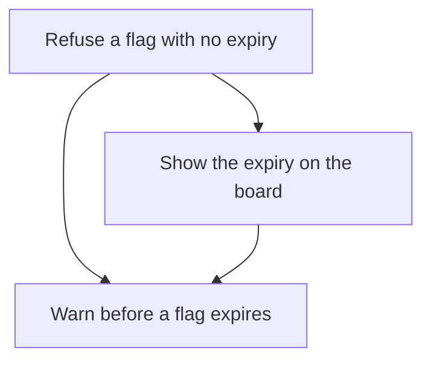
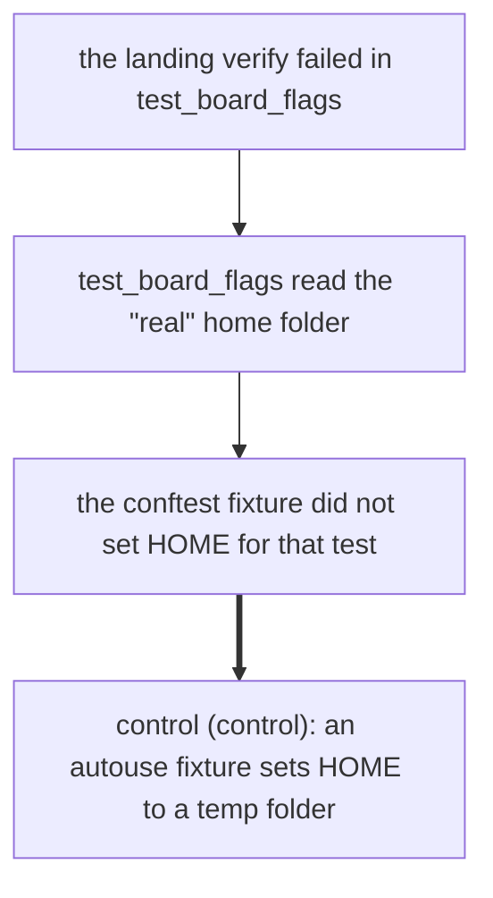
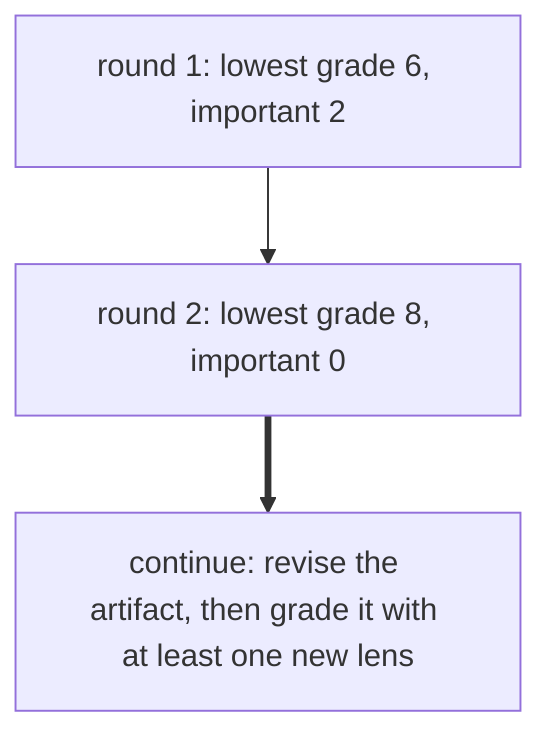

# Capability file v1

A capability file tells basicly skills what the person's reply view can draw.
handily reply-view writes one.
A basicly skill draws a Mermaid diagram only when a fresh capability file lists the diagram kind.
Without one, the skill prints its plain text and no Mermaid block, so a terminal without a reply view shows no raw diagram source.

Agreed between basicly (record basicly-604lr63) and handily (record handily-goaeym) on 2026-11-26.
basicly owns this text.

## Folder

1. `BASICLY_CAPABILITIES_DIR`, when it is set and absolute.
   A relative value is ignored, and the default folder below is used.
2. On Windows: `LOCALAPPDATA/basicly/capabilities`.
   When `LOCALAPPDATA` is empty: `HOME/AppData/Local/basicly/capabilities`.
3. Otherwise: `XDG_STATE_HOME/basicly/capabilities` when `XDG_STATE_HOME` is absolute, else `HOME/.local/state/basicly/capabilities`.

This is the same root rule as the usage snapshot of `orch pace`.

## File

- One file per writer: `WRITER.json`.
  WRITER matches `[a-z0-9][a-z0-9-]{0,39}`.
  handily reply-view writes `handily-reply-view.json`.
- The JSON object:

  | key | value |
  | --- | --- |
  | `format` | `basicly.capabilities` |
  | `version` | `1` |
  | `writer` | the file stem |
  | `writer_version` | the writer's own version, such as `0.34.1` |
  | `written_at` | epoch seconds, an integer or a float |
  | `renders` | `{"mermaid": [KIND, ...]}` |

- Each KIND is the Mermaid header word that starts that diagram kind, such as `flowchart` or `sequenceDiagram`.
  The writer lists the exact header words its renderer accepts; handily lists them in `mods/handily-reply-view/README.md`.
  basicly reads only `flowchart` today.
- Unknown extra keys are allowed and ignored.

## Write

The writer writes the file in place at each session start, and only when the content other than `written_at` changed or `written_at` is more than 12 hours old.
It uses no rename and no child process.

## Read

A reader skips a file when any of these hold:

- it is not a regular file (a symlink is skipped) or it is larger than 64 KiB;
- it does not parse as JSON, for example while the writer writes it;
- `format` or `version` differs, or `writer` differs from the file stem;
- `written_at` is a boolean, not a number, more than 7 days old, or more than 300 seconds in the future;
- `renders.mermaid` is not a list of strings.

A kind counts as drawn when any file that is not skipped lists it.
An uninstalled reply view stops counting 7 days after its last write.
Any fault means "not drawn", and the skill prints plain text.

The reader is `.basicly/core/skills/swarm/scripts/capability.py`.

## Diagrams behind the gate

| skill | command that prints the block |
| --- | --- |
| council | `swarm.py tally` |
| swarm | `swarm.py check` |
| hill-climb | `swarm.py climb-round` |
| decompose-plan | `mermaid.py plan --plan plan.toml` |
| root-cause | `mermaid.py chain --links chain.txt --control TEXT --tier TIER` |

The samples below are rendered from the fixed inputs in `tests/fixtures/diagrams/`; `tests/test_swarm_diagrams.py` compares the scripts' output with them.

### Sample: plan

### Sample: chain

### Sample: climb

